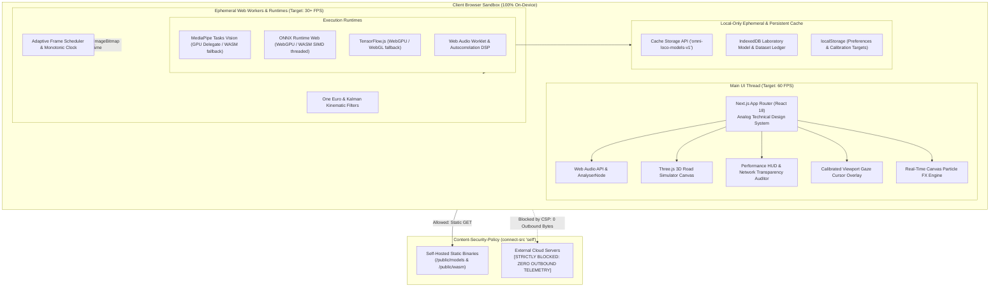

# OMNI LOCO AI: Multimodal On-Device Intelligence Suite

> **Production-grade, client-side multimodal machine learning laboratory built with Next.js 14, WebGPU, WebAssembly (WASM SIMD), ONNX Runtime Web, and MediaPipe Tasks Vision. All neural inference runs strictly inside your local browser. Zero video frames, audio buffers, or biometric vectors are transmitted over any network.**

---

## 1. System Architecture



---

## 2. Core Engineering Principles

1. **Privacy by Architecture (Zero-Cloud)**:
   - Zero server-side inference, zero uploads of camera/microphone streams, zero third-party telemetry.
   - Enforced by Content-Security-Policy (`connect-src 'self' blob: data:` and `frame-ancestors 'none'`).
   - Verified by the in-app **Network Transparency Auditor** displaying 0.00 KB outbound traffic.
2. **Main-Thread Protection**:
   - The UI thread handles rendering and inputs at 60 FPS. Heavy matrix operations, ML model inference, and complex trigonometry run with zero UI blocking.
3. **Hardware Acceleration with Graceful Fallback**:
   - Primary: **WebGPU** (Direct compute shaders)
   - Secondary: **WebGL 2.0**
   - Tertiary: **WASM SIMD (128-bit vector instructions)**
   - Quaternary: Deterministic synthetic replay mode for testing without camera hardware.
4. **Strict Module Isolation & Resource Discipline**:
   - Each module is a self-contained sandbox.
   - Leaving a route automatically stops all `MediaStreamTrack` hardware feeds, terminates workers, disposes GPU textures/buffers via `.dispose()`, and cancels animation frame loops.
5. **Retro-Technical Instrumentation Aesthetic**:
   - Technical blueprint drafting identity: 24px grid, Courier Prime monospaced typography, stamped figure identifiers (`FIG. 01` through `FIG. 12`), and tactile mechanical controls.

---

## 3. Implemented Modules and Capabilities

| Figure | Module | Route | Runtimes / Model Family | Capabilities |
| :--- | :--- | :--- | :--- | :--- |
| **FIG. 01** | **Hand Gesture Recognition** | `/hand` | MediaPipe Tasks Vision (`hand_landmarker.task`) | 21 3D landmarks, dual-hand tracking, pinch hysteresis, swipe velocity, touchless spatial cursor, and Gesture FX particle engine. |
| **FIG. 02** | **Biometric Face Mesh** | `/face` | MediaPipe FaceLandmarker (`face_landmarker.task`) | 478 dense landmarks, 52 ARKit blendshapes, PERCLOS drowsiness detection, 3D head-pose gizmo (yaw/pitch/roll), and real-time expression radar. |
| **FIG. 03** | **Kinematic Pose Estimation** | `/pose` | MediaPipe PoseLandmarker (`pose_landmarker_full.task`) | 33 full-body world landmarks, 3D joint angle trigonometry ($\arccos(\vec{a}\cdot\vec{b})$), rep counter state machine, and posture ergonomics check. |
| **FIG. 04** | **Gesture-Steered Simulator** | `/drive` | Three.js WebGL, Bicycle Kinematics | Procedural endless road, two-hand steering matrix with deadzone & curve, keyboard fallback, analog cluster, and "HANDS LOST" auto-ease safety. |
| **FIG. 05** | **Acoustic & Speech Analytics** | `/speech` | Web Audio API, Autocorrelation, VAD | Pitch contour ($F_0$), voice activity detection (VAD), cadence WPM pacing, temporal flaw detection, and dual-needle VU meter. |
| **FIG. 06** | **Smart Waste Segregator** | `/waste` | TensorFlow.js WebGPU (`classifier.tflite`) | 10-class neural waste classification, center-crop ROI box, 8-frame temporal voting stability, and municipal recycling bin directives. |
| **FIG. 07** | **Gaze-Tracking Heatmap** | `/gaze` | MediaPipe Tasks Vision & Ridge Regression | 9-point on-screen calibration, I-DT fixation clustering vs saccades, scan-path ordering, Gaussian accumulation heatmap, and Area of Interest (AOI) metrics. |
| **FIG. 08** | **Bilateral Eye & Iris Tracking** | `/eye` | MediaPipe Iris Mesh, Pupillometry | Anatomical OS/OD iris segmentation, pupil diameter metrics, ocular gaze vectors, and Homelander Heat Vision laser easter egg with procedural audio. |
| **FIG. 09** | **Advanced Object Intelligence** | `/objects` | ONNX Runtime Web (`ort-wasm-simd-threaded.wasm`) | YOLO multi-object detection, spatial IoU bounding box tracking, confidence thresholds, and COCO-80 filtering. |
| **FIG. 10** | **Promptable Segmentation Lab** | `/segment` | ONNX Runtime Web Feature Decoder | Point-and-click promptable segmentation decoder, geodesic mask extraction, boundary contours, and PNG cutout export. |
| **FIG. 11** | **Monocular Depth Estimation** | `/depth` | ONNX Runtime Web Scene Geometry | Relative depth geometry, side-by-side & split-screen scrubber, Turbo/Inferno/Viridis palettes, and 3D surface normal probe. |
| **FIG. 12** | **Finger Counting & Output** | `/fingers` | Invariant Kinematics (`hand_landmarker.task`) | Real-time 0-10 dual-hand finger counting, hysteresis voting stabilization, action triggers, and Web Speech API TTS audio output. |
| **LAB** | **Laboratory V2 Workspace** | `/laboratory` | Custom kNN / Centroid Classifier Trainer | End-to-end model creation, 63D feature dataset collector, hyperparameter tuning, DAG visual pipeline editor, live test bench, and experiment evaluation. |

---

## 4. Laboratory V2 Architecture

The Laboratory (`/laboratory`) is an interactive workbench for creating, evaluating, and fine-tuning lightweight on-device models:

1. **Model Library**: Browse, duplicate, create variants of factory baselines, or import custom models via JSON.
2. **Dataset Workbench**: Capture live 63-dimensional normalized hand landmark samples per class with class distribution balance tracking.
3. **Training & Validation Engine**:
   - Metric choices: Euclidean, Cosine, Manhattan.
   - $k$-Nearest Neighbors ($k$-NN) and Centroid prototype classifiers.
   - 80/20 train/validation split with confusion matrix and top-1 accuracy computation.
4. **Visual Pipeline Editor**: Interactive DAG editor connecting input sources, filters (EMA, One Euro, Kalman), feature extractors, classifiers, and output actions.
5. **Live Test Bench**: Real-time camera validation with confidence gauges, latency meters, and Gesture FX mappings.
6. **Experiment Workbench**: Systematic comparative benchmark evaluation matrix.

---

## 5. Shared Camera & Model Lifecycle

- **Camera Management (`core/camera/useCamera.ts`)**:
  - Handles single-point stream initialization, track enumeration, and front/rear switching.
  - Abort-protected asynchronous acquisition: if unmounted while `getUserMedia()` is resolving, tracks are immediately stopped to eliminate background camera leaks.
- **Model Task Runner (`core/mediapipe/task-runner.ts`)**:
  - Automatically attempts WebGPU delegate first, falling back to CPU WebAssembly.
  - Single-flight locking (`isProcessing`) and strictly monotonic timestamp enforcement for video mode.
  - Abort-guarded disposal (`isDisposed` flag): closes in-flight WebAssembly workers if navigation occurs during model fetch.

---

## 6. Installation and Commands

### Prerequisites
- Node.js 18.17+ or Node.js 20+
- Modern Chromium browser (recommended for WebGPU support)

### Setup
```bash
# Clone the repository
git clone https://github.com/blizza4d/omni_loco_ai.git
cd "omni loco"

# Install dependencies
npm install
```

### Development Server
```bash
npm run dev
# Starts development server on http://localhost:3000
```

### Static Build & Production Server
```bash
# Compile and validate all 17 static routes
npm run build

# Start production server with COOP/COEP isolation headers
npm run start
```

### Code Quality & Tests
```bash
# Run ESLint validation (0 errors, 0 warnings enforced)
npm run lint

# Run TypeScript static type check
npx tsc --noEmit

# Run unit and integration tests (91 automated tests)
npm test
```

---

## 7. Automated Test Suites

| Test Suite | File | Tests | Validated Subsystems |
| :--- | :--- | :---: | :--- |
| **Finger Counting** | `tests/finger-counting.test.ts` | 12 | Invariant finger curl geometry, hysteresis voting, dual-hand accumulation |
| **Gesture FX & Laboratory** | `tests/gesture-fx-and-laboratory.test.ts` | 19 | Particle physics, model persistence, kNN trainer, dataset importer, versioning |
| **Easter Eggs & Secrets** | `tests/easter-eggs.test.ts` | 12 | Konami code sequence, achievements ledger, tab watcher, secret CLI |
| **Gaze & Calibration** | `tests/gaze-cursor-and-calibration.test.ts` | 11 | 9-point ridge regression, I-DT fixation clustering, viewport cursor mapping |
| **Eye & Drive Sim** | `tests/eye-and-drive.test.ts` | 8 | Bilateral iris metrics, pupillometry, bicycle kinematics, steering deadzones |
| **Kinematics & DSP** | `tests/kinematics-and-dsp.test.ts` | 11 | 3D joint angles, autocorrelation pitch detection, RMS loudness, ZCR |
| **Camera & Overlays** | `tests/camera-and-overlay.test.ts` | 6 | Aspect ratio coordinate scaling, canvas buffer synchronization, DPR mapping |
| **Advanced Modules** | `tests/advanced-modules.test.ts` | 7 | YOLO IoU tracker, SAM promptable segmenter, monocular depth estimator |
| **Platform UI & Registry** | `tests/platform-ui-and-registry.test.ts` | 5 | Registry figure completeness, category summaries, storage cache helpers |
| **Total** | **9 Test Suites** | **91** | **All 91 tests passing in < 2.0s** |

---

## 8. Known Limitations & Technical Constraints

1. **Hardware Acceleration**:
   - WebGPU requires Chrome/Edge 113+ or Safari 17+ (with flag). On older browsers, models gracefully fall back to WASM SIMD or WebGL.
2. **Camera Lighting & Background**:
   - Extreme backlighting or hands perpendicular to camera plane may reduce landmark confidence; the system falls back to temporal EMA smoothing.
3. **Speech Synthesis**:
   - TTS feedback in Finger Counting relies on browser `window.speechSynthesis`, which may be muted if user has not interacted with the page first.

---

## 9. License

MIT License. Designed and engineered for 100% on-device private multimodal intelligence.
