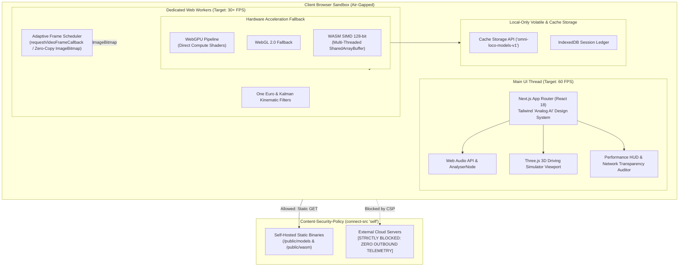

# OMNI LOCO AI: Multimodal On-Device Intelligence Suite

> **Production-grade, fully client-side multimodal machine learning laboratory built with Next.js 14, WebGPU, and WebAssembly (WASM). All neural inference runs strictly inside your local browser. Zero video, audio, or biometric data ever leaves the device.**

---

## 1. System Architecture



---

## 2. Non-Negotiable Engineering Principles

1. **Privacy by Architecture**:
   - Zero server-side inference, zero uploads of camera/microphone frames, zero third-party telemetry.
   - Enforced by strict Content-Security-Policy: `connect-src 'self' blob: data:` and `frame-ancestors 'none'`.
   - Visible **"100% On-Device"** badge and interactive **Network Transparency Auditor** displaying verified zero-byte outbound data transmission.
2. **Main-Thread Protection**:
   - The UI thread only renders and handles input. All matrix inference, audio DSP, and heavy trigonometry run in Web Workers.
   - Smooth 60 FPS UI rendering while inference runs at 30+ FPS.
3. **Hardware Acceleration with Graceful Fallback**:
   - Primary: **WebGPU** (Direct GPU compute pipelines)
   - Secondary: **WebGL 2.0**
   - Tertiary: **WebAssembly SIMD (128-bit vector instructions)** and multithreaded workers via `SharedArrayBuffer`
   - Quaternary: Deterministic synthetic replay mode for headless and camera-less environments.
4. **Strict Module Isolation & Resource Discipline**:
   - Each module is a self-contained sandbox.
   - Leaving a route automatically terminates its worker thread, calls `MediaStreamTrack.stop()`, disposes GPU textures/buffers via `tf.dispose()`, and releases camera/mic hardware.
5. **"Analog AI / Engineer's Desk" Design System**:
   - Physical drafting desk aesthetic: 24px blueprint grid, paper grain texture, stamped corner figures (`FIG. 01` through `FIG. 07`), Courier Prime technical typography, and mechanical tactile buttons with 3px collapsing offset shadows (`shadow-tactile`).

---

## 3. Multimodal Laboratory Modules

| Figure | Module | Route | Technologies | Capabilities |
| :--- | :--- | :--- | :--- | :--- |
| **FIG. 01** | **Hand Gesture Recognition** | `/hand` | MediaPipe Tasks Vision, One Euro Filter | 21 3D landmarks, dual-hand tracking, pinch hysteresis, swipe velocity, and touchless virtual spatial mouse cursor. |
| **FIG. 02** | **Biometric Face Mesh** | `/face` | 478 Landmarks, 52 ARKit Blendshapes | Eye Aspect Ratio (EAR) blink frequency, PERCLOS drowsiness detection, 3D head-pose gizmo (yaw/pitch/roll), and vocal activity detection. |
| **FIG. 03** | **Kinematic Pose Estimation** | `/pose` | 33 World Landmarks, 3D Vector Math | 3D joint angle trigonometry ($\arccos(\vec{a}\cdot\vec{b})$), hysteresis rep counter for squats, push-ups, curls, and desk worker forward-head ergonomics check. |
| **FIG. 04** | **Driving Simulator** | `/drive` | Three.js WebGL, Bicycle Kinematics | Procedural endless road, two-hand steering matrix with deadzone and progressive non-linear curve, analog instrument cluster, and "HANDS LOST" auto-ease safety. |
| **FIG. 05** | **Acoustic & Speech Analytics** | `/speech` | Web Audio API, Autocorrelation, VAD | Fundamental frequency pitch contour ($F_0$), voice activity detection (VAD), cadence WPM pacing, temporal flaw detection, and dual-needle VU meter. |
| **FIG. 06** | **Waste Segregation Scanner** | `/waste` | TensorFlow.js WebGPU, MobileNetV3 | 10-category waste classification, center-crop ROI box, 8-frame temporal voting stability, and municipal recycling bin directives. |
| **FIG. 07** | **Gaze Heatmap Generator** | `/gaze` | Refined Iris Vectors, Ridge Regression | 9-point on-screen calibration, I-DT fixation clustering vs saccades, scan-path ordering, Gaussian accumulation heatmap, and Area of Interest (AOI) metrics. |

---

## 4. Browser Support Matrix

| Browser | WebGPU Acceleration | WebGL Fallback | WASM SIMD & Threads | Status |
| :--- | :---: | :---: | :---: | :--- |
| **Google Chrome / Chromium** (113+) | Full Native | Supported | Supported (COOP/COEP) | Recommended |
| **Microsoft Edge** (113+) | Full Native | Supported | Supported (COOP/COEP) | Recommended |
| **Mozilla Firefox** (120+) | Experimental | Full Native | Supported (SIMD enabled) | Supported |
| **Apple Safari** (17+) | WebGPU Flag | Full Native | Supported (WASM SIMD) | Supported |
| **Mobile Browsers (iOS / Android)** | Tier Dependent | Full Native | Supported | Responsive & Front/Rear Switching |

---

## 5. Performance Tuning Guide

1. **Cross-Origin Isolation (COOP & COEP)**:
   Configured in `next.config.mjs`:
   ```javascript
   { key: 'Cross-Origin-Opener-Policy', value: 'same-origin' },
   { key: 'Cross-Origin-Embedder-Policy', value: 'require-corp' }
   ```
   This unlocks `SharedArrayBuffer`, allowing multi-threaded WebAssembly and atomic memory sharing across Web Workers without inter-thread data copying.

2. **Adaptive Frame Scheduler & Zero Queue Backlog**:
   The `AdaptiveFrameScheduler` in `core/scheduler/adaptive-scheduler.ts` tracks worker inference latency. If inference takes longer than the frame budget ($>33.3\text{ms}$), incoming camera frames are immediately dropped rather than queued, eliminating video latency drift.

3. **Zero-Copy ImageBitmap Transfers**:
   Frames captured from `<video>` are converted into `ImageBitmap` primitives and posted to workers as `Transferable` objects (`worker.postMessage(msg, [bitmap])`). The underlying GPU/system memory pointer transfers ownership in $0\text{ms}$.

4. **One Euro Smoothing**:
   All spatial cursor and joint coordinates pass through Casiez's One Euro adaptive low-pass filter:
   $$\alpha = \frac{1}{1 + \frac{\tau}{T_e}}, \quad \text{where } \tau = \frac{1}{2\pi (f_c + \beta |\dot{x}|)}$$
   This guarantees jitter-free stability when hands dwell, and low-latency tracking during fast sweeps.

---

## 6. Verification and Testing

Omni Loco AI includes Vitest unit tests verifying all mathematical formulas, vector kinematics, and DSP algorithms:

```bash
# Run complete unit test suite
npm test

# Build production bundle with full type safety
npm run build

# Start local server with COOP/COEP headers
npm run start
```

---

## 7. License

MIT License. Designed and engineered for 100% on-device private multimodal intelligence.
# omni_loco_ai
# omni_loco_ai
# omni_loco_ai
